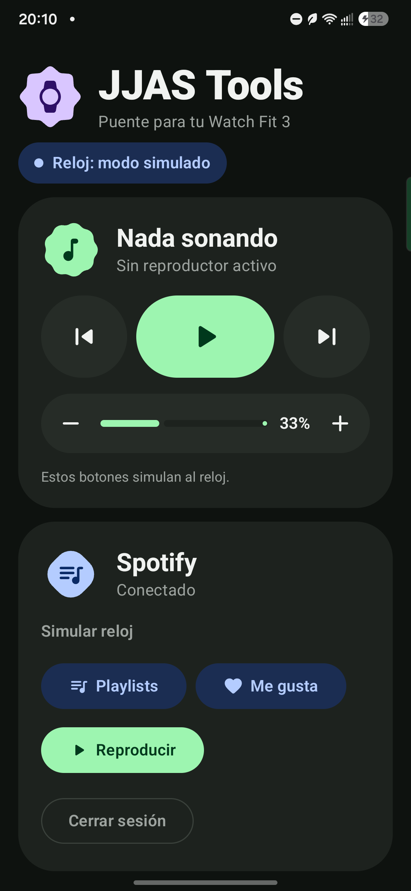
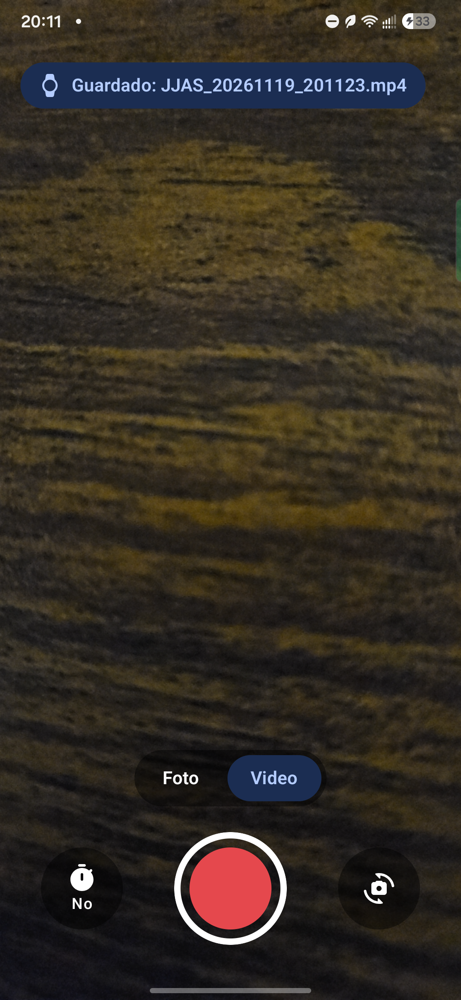
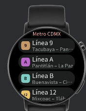

# JJAS Tools para Huawei Watch Fit 3

Suite de apps propias con estilo **Material 3 Expressive** para el **Huawei Watch Fit 3** (`liteWearable`) y su app compañera para **Android** (probada en Galaxy S23).

<p align="center">
  
  
  
  
</p>

## Arquitectura

```
[watch/  app JS lite wearable]  <--Wear Engine P2P (Bluetooth)-->  [phone/  app compañera Android]
   interfaz, corona y sensores                                       Cámara, Spotify, clima, dólar, SMS...
```

El reloj no tiene internet propio ni ejecuta apps en segundo plano: la app compañera del teléfono consulta APIs públicas gratuitas (Frankfurter para USD→MXN, Open-Meteo para clima), controla Cámara/Spotify y envía notificaciones que Huawei Health pasa al reloj.

| Carpeta | Qué contiene |
|---|---|
| `watch/` | Proyecto de DevEco Studio (HarmonyOS `liteWearable`, JS + `<canvas>` M3 Expressive) |
| `phone/` | Proyecto de Android Studio (Kotlin + Jetpack Compose M3 Expressive + CameraX) |
| `scripts/` | Generador de íconos/sprites (`gen_watch_icons.py`), compilador lite (`check_watch.sh`) y pruebas unitarias (`test_*.mjs`) |
| `docs/roadmap.md` | Plan completo de funciones, viabilidad y registro por agente |
| `docs/protocol.md` | Protocolo JSON entre el reloj y el teléfono |
| `docs/setup.md` | Cuenta de desarrollador, certificados, UDID e instalación |

## Funciones listas ✅

### En el reloj (`watch/`)
- **☀️ Now Brief:** resumen del día con saludo, clima + alertas inteligentes (lluvia/viento/calor/frío), efemérides de México, pila de la bici, jornada, Tarjeta MI y dólar.
- **🎵 Música y Playlists:** control multimedia con color dinámico M3 por canción, portada animada, **barra de avance sinusoidal** y volumen con la corona.
- **📸 Cámara (Foto y Video):** obturador remoto con temporizador (`0/3/10 s`), voltear cámara y grabación de video con cronómetro.
- **🔋 Baterías (Bici y Reloj):** autonomía estimada real con **anillos ondulados M3 Expressive**.
- **💰 Mi jornada:** anillo ondulado de turno, dinero ganado en vivo (editable por hora o desde nómina quincenal) y cronómetro de costo de junta.
- **🚇 Metro CDMX + 💳 Tarjeta MI:** 12 líneas, 195 estaciones sin internet, transbordos, aviso 1 estación antes de bajar y saldo de Tarjeta MI.
- **⚖️ Convertidor de unidades:** `USD ↔ MXN` (sincronizado vía puente), `lb ↔ kg`, `°F ↔ °C`, `mi ↔ km`, `oz ↔ g`, `ft ↔ m` con la corona.
- **📍 Lugares GPS + 🔬 Prueba de sensores:** tags con distancia/flecha (Bici, Carro, Casa Koala, Trabajo, Parquímetro) y diagnóstico de GPS, brújula, pulso, pasos y acelerómetro.
- **🐨 Koala Científico:** tamagotchi pixel art (portado de `koala_monitor`) conectado a tus pasos y viajes en bici.
- **🔧 Bici Kit:** checklist antes de salir, mantenimiento por km y **direccionales nocturnas** parpadeantes.
- **🍅 Pomodoro / HIIT, 💧 Hábitos, 🔢 Contador, 🧾 Propinas, 🎲 Para decidir, 💸 QR nativo, 🚗 Hoy No Circula, 🃏 Anki EN y 📳 Hora táctil en vibraciones.**

### En el teléfono (`phone/`)
- **Control multimedia y Spotify** (OAuth PKCE, playlists y reproducción).
- **Cámara Foto + Video** (CameraX `ImageCapture` + `VideoCapture`, funciona sobre pantalla de bloqueo).
- **🚴 Seguridad y bici (Fase 2):** aviso de ubicación por SMS cada hora ("Salí en bici" / "Ya llegué"), respuesta automática a "¿Dónde estás?" solo al contacto autorizado, y alerta "¿Llevas todo?" al salir del Wi-Fi.
- **Puentes de datos:** dólar diario (Frankfurter / open.er-api) y clima CDMX (Open-Meteo), ambos gratuitos sin API key.

Plan completo y siguientes fases: [docs/roadmap.md](docs/roadmap.md)
